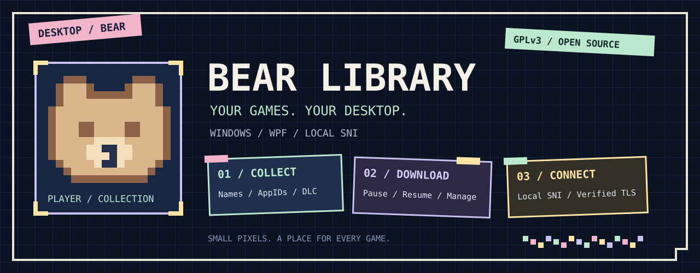

<div align="center">



### 把游戏、封面和下载，收进自己的桌面。

**Bear 游戏库** · Windows 桌面游戏库与下载管理工具


[功能一览](#功能一览) · [快速开始](#快速开始) · [下载原理](docs/download-design.md) · [参与开发](CONTRIBUTING.md) · [致谢](#感谢每一份帮助)

</div>

---

> **这是一份可以阅读、修改和自行构建的源码版本。**
> 仓库不包含运营服务地址、上游资料适配器、游戏清单、depot key、Lua 资料包、用户数据或预编译补丁。下载资料由使用者自行提供；可选服务地址由使用者配置。

## 功能一览

| ▦ COLLECT · 游戏库 | ↓ DOWNLOAD · 下载管理 | ◇ CONNECT · 本地网络 |
| :--- | :--- | :--- |
| 名称、AppID 与商店链接查询<br/>本地筛选与在线搜索分开保存<br/>封面缓存与 DLC 公开列表 | 真实接收速度与安装进度<br/>自动并发、暂停与退出后恢复<br/>删除任务与管理未完成文件 | 默认开启的本地 SNI 模式<br/>动态地址提示与 CDN 切换<br/>保留代理设置和证书认证 |

### ▦ 游戏库与封面

- 按游戏名称、AppID 或 Steam / SteamDB 链接查找条目。
- 支持手动 AppID 离线添加，管理条目、映射和启用状态。
- 在本地游戏库即时筛选；保留在线搜索的文字和结果。
- 封面可独立于商店详情加载，最多并发加载三张。
- 图片节点不可用时尝试备用节点，缓存为压缩图片，并按容量上限淘汰。
- 查看商店公开的 DLC 列表，支持筛选、全选和批量加入游戏库。

### ↓ 下载与安装记录

- 下载当前选择的 Windows public 本体内容，并按语言选择适用 depot。
- 显示准备阶段、安装进度、实际接收速度、当前并发数和目标目录。
- 从 Steam 内容服务器目录发现适合当前网络的节点，按实际内容传输表现分配任务；香港节点保留为补充。
- 默认自动调整 8–32 并发，也可手动选择；增加并发没有收益时会回退。
- 游戏内容默认直连，可独立改为跟随软件代理；商店和资料查询继续使用原代理设置。
- 保存任务计划和已完成块记录；暂停、关闭窗口或退出程序后可继续。
- 文件放入所选 Steam 游戏库的 `steamapps/common`。
- 下载完成后写入相应安装记录，供 Steam 识别已落盘内容。
- 支持删除任务，并选择是否删除对应的未完成文件；已有安装记录的游戏受到保留规则约束。
- 当前不提供独立 DLC 安装、任意分支切换或账号许可管理。DLC 条目管理与 DLC 文件下载是不同功能。

**源码版的下载前提：**使用者提供对应的游戏信息、manifest 和 depot key，或配置兼容的资料接口。程序不内置这些资料，也不列出它们的获取来源。安装记录本身不授予游戏许可。

### ◇ 本地 SNI 与网络连接

- 在“补丁与设置”中启用或关闭本地 SNI，加速仅作用于 Bear 自身的请求。
- 未使用代理时，客户端可连接候选节点，以不发送域名 SNI 的方式建立 TLS。
- HTTP 请求仍使用原始域名；证书链和原域名认证继续执行。
- 节点返回错误域名的证书时拒绝该连接，并回到普通连接路径。
- 下载器复用连接，并在节点失败时尝试其他 Steam CDN 节点。
- 按官方目录声明使用内容节点的 HTTP 或 HTTPS 协议；HTTPS 继续验证证书。部分地区内容节点需要额外的 Steam 会话 CDN 授权，当前无会话下载器会跳过拒绝访问的节点。
- 查询连接及选择“跟随设置中的代理”的游戏内容连接支持手动代理和系统代理；游戏内容选择直连时不使用这些代理。
- 不需要安装本地根证书，不修改系统 hosts，也不启动全局代理。

不同节点、运营商和网络环境的结果可能不同。这个模式改善连接可用性，不保证固定下载速度。

### ▤ 配置、备份与可选补丁管理

- 设置、游戏库、任务与续传记录保存在程序旁的 `data` 目录。
- 自动备份最多保留五份；卸载需要的原文件按恢复用途单独保留。
- 保留隐身模式、隐士模式的管理界面，以及客户端结构检测、安装事务、卸载和恢复逻辑。
- **补丁二进制不随源码分发。** 未提供相应资源时，源码构建不能安装这两种补丁；其余游戏库、网络和下载框架可以构建使用。
- 提供签名更新框架。公开源码未配置维护者的生产签名信任，默认关闭自动检查和下载；自行发行时应配置自己的签名公钥。

## 快速开始

### 1 · 准备环境

- Windows 10 / 11 x64。
- .NET 8 SDK，项目的 `global.json` 提供 SDK 选择规则。
- Python 3.11 或更新版本；自动构建使用 Python 3.13。
- Git，以及构建时访问公开依赖下载站点的网络连接。

### 2 · 从源码构建

```powershell
git clone https://github.com/BearYeah/bear-game-library-source.git
cd bear-game-library-source
python -m venv .venv
.\.venv\Scripts\Activate.ps1
python -m pip install -r requirements.txt
python Build/publish.py
```

输出目录为 `dist`，主程序为 `dist/BearLibrary.exe`。脚本从公开上游获取 curl 与 CA 包，再从本仓库源码构建下载器和桌面程序。源码仓库不附带预编译的 Bear 程序。

仓库提供 [GitHub Actions 构建模板](docs/build-workflow.example.yml)。将其放入 `.github/workflows/build.yml` 后可启用相同构建，并保存构建产物。模板不需要仓库密钥，也不会自动发布 Release。

只调试界面时可以使用 `dotnet run`；兼容联网和下载引擎仍需先准备对应资源。

### 3 · 运行与配置

1. 启动程序，在“补丁与设置”中选择 Steam 目录。
2. 需要代理时填写地址；留空则使用当前系统代理设置。
3. 搜索或手动加入游戏，使用详情页查看资料与公开 DLC 条目。
4. 下载前准备自己的资料并选择游戏库目录。任务在“下载管理”中查看。
5. 更新程序时保留自己的 `data`；分发程序时不要附带个人 `data`。

可选配置见 [配置说明](docs/configuration.md)。仓库仅提供配置约定和接口结构，不提供生产服务地址。

## 下载原理

```text
使用者提供的游戏信息、manifest、depot key
                      │
                      ▼
            选择平台 / 语言 / depot 版本
                      │
                      ▼
             解析文件列表、分块及偏移
                      │
                      ▼
           Steam CDN → 解密 / 解压 → 落盘
                      │
                      ▼
         保存续传记录 → 完成后登记安装信息
```

manifest 描述文件和分块；depot key 用于解密相应内容；Lua 可作为声明这些信息的文本载体。**程序解析 Lua 文本，不执行 Lua 代码。** 完整说明见 [下载设计](docs/download-design.md)；可选接口见 [资料接口协议](docs/provider-protocol.md)。

## 项目地图

| 路径 | 内容 |
| :--- | :--- |
| `MainWindow*.cs` / `*.xaml` | 桌面交互、游戏卡片与下载管理 |
| `Models.cs` / `Storage.cs` | 游戏库模型、持久化与缓存 |
| `SteamStore.cs` / `SteamSniTransport.cs` | 商店、封面与本地 SNI |
| `DownloadBackend/` | 清单解析、内容块处理、续传和安装登记 |
| `PatchService.cs` / `ClientCompatibility.cs` | 可选补丁管理和兼容性检测逻辑 |
| `Updates.cs` / `UpdateSignature.cs` | 签名更新框架 |
| `Build/` | 公开版构建与隔离测试 |
| `docs/` | 原理、配置与接口说明 |

## 开发与测试

```powershell
python Build/test.py
```

测试使用本地 TLS 服务、合成数据及隔离目录，不读取真实账号，也不修改真实 Steam。已构建桌面程序时会一并运行 WPF 事件测试。补丁安装的完整回归需要另外准备相应资源，不属于无资源公开构建的测试范围。

欢迎提交问题报告和 Pull Request。请先阅读 [CONTRIBUTING.md](CONTRIBUTING.md)，并只提交脱敏的复现资料。

## 感谢每一份帮助

Bear 从一个方便自己整理游戏的小工具，逐步长出了下载管理、封面缓存和本地网络功能。感谢每一位认真反馈问题、提出建议、陪伴测试的朋友；一次具体的反馈，常常就是下一个改进的起点。

也感谢以下开源项目与生态，让这些功能有了可靠的基础：

| 项目 | 帮助 |
| :--- | :--- |
| [.NET / WPF](https://github.com/dotnet/wpf) | Windows 桌面与运行时基础 |
| [Python](https://github.com/python/cpython) | 下载工作进程与构建工具 |
| [Requests](https://github.com/psf/requests) / [urllib3](https://github.com/urllib3/urllib3) | HTTP、连接池与 TLS 接入 |
| [cryptography](https://github.com/pyca/cryptography) / [python-zstandard](https://github.com/indygreg/python-zstandard) | 密码学原语与内容解压 |
| [curl](https://github.com/curl/curl) | 兼容联网组件 |
| [Watt Toolkit](https://github.com/BeyondDimension/SteamTools) | 本地网络、SNI 与域名处理的设计参考 |
| [SteamHostSync](https://github.com/Clov614/SteamHostSync) | 网络地址提示的实现参考 |
| [PyInstaller](https://github.com/pyinstaller/pyinstaller) | 下载工作进程打包 |

致谢所列项目是依赖或设计参考，**不表示它们提供本项目的游戏资料**。第三方许可证与边界见 [THIRD_PARTY_NOTICES.md](THIRD_PARTY_NOTICES.md)。

## 许可证

本仓库原创代码以 **GNU GPL v3.0 only（GPL-3.0-only）** 发布，完整文本见 [LICENSE](LICENSE)。分发修改后的程序时，请遵守 GPLv3 对对应源码和许可证的要求。第三方组件继续适用各自的许可证。

<div align="center">

**▦ 由 lostlybear 制作 · 给每一款游戏留一个位置 ▦**

</div>
